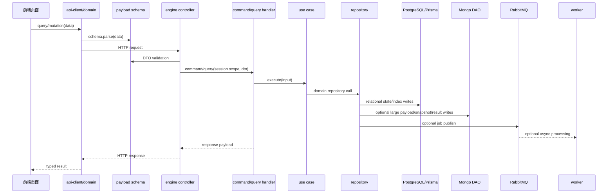

# Ray API Flow

用于新增、修改或审计接口时，约束从前端请求到服务端持久化的标准数据流转。触发场景包括：新增 HTTP API、补充 `libs/api-client` domain 封装、修改 `libs/payload` Zod schema、实现 engine command/query/use case/repository，或涉及 PG/Mongo/RabbitMQ 的数据链路。

## 必须先读

- 如果任务触碰 `services/engine` 或新增 `libs/pg-dao` model，先读 `.agents/commands/setup-saas-feature.md`。
- 如果需要了解 Nx 项目和 target，先使用 `nx-workspace` skill。
- 如果涉及数据库结构设计，结合 `database-schema-designer` skill，但以现有 schema 和归属模型为准。

## 标准链路

新增接口优先按这个顺序落地：

1. `libs/payload/src/schemas/<domain>`：定义请求、响应和列表 payload 的 Zod 契约。
2. `libs/api-client/src/domains/<domain>.ts`：按 domain 封装 query/mutation，并在提交前复用 payload schema 校验请求。
3. `services/engine/src/presentation/http/<domain>`：controller 只处理 Better Auth session、DTO 验证和 CQRS 分发。
4. `services/engine/src/application/commands|queries/<domain>`：command/query handler 只做应用入口编排，不直接写 Prisma。
5. `services/engine/src/application/use-cases/<domain>`：承载业务编排、领域规则、权限归属解析和调用仓储。
6. `services/engine/src/domain`：补齐 entity、value object、repository interface、domain exception。
7. `services/engine/src/infrastructure/repositories`：实现 PG/Mongo/S3/Redis 等实际数据访问。
8. `libs/pg-dao/src/models` 与 `libs/mongo-dao/src/schemas`：只在确实需要新的持久化结构时修改。

## Mermaid 模板

用下面模板解释或审计一条接口链路：



如果接口不需要 Mongo、RabbitMQ 或 worker，删除对应泳道即可；不要为了套模板引入不必要的异步任务或附属存储。

## 归属模型

- 归属边界必须贴合 Better Auth：个人数据使用 `userId`，组织数据使用 `activeOrganizationId` / `organizationId`。
- Controller 和 handler 不能信任请求体中的用户或组织归属字段。
- 有 `organizationId` 时按组织归属过滤；没有 `organizationId` 时按 `ownerUserId + organizationId: null` 过滤个人数据。
- 不要引入 `workspaceId`、`projectId` 这类额外抽象，除非明确重新定义产品模型。

## Payload 与 API Client

- 请求和响应类型必须从 `@libs/payload` 导出，避免前端手写重复 DTO。
- mutation 在发起请求前尽量执行同一份 Zod schema 的 `parse`，让前端校验和 engine DTO 校验一致。
- 只把当前 use case 能真正执行的来源类型、状态和字段开放到创建请求 schema。
- 预留枚举可以留在 `libs/common` 或响应 schema，但不要放进创建请求白名单。
- 删除没有消费者的字段；未被仓储、worker 或响应使用的 payload 字段属于僵尸代码。

## Engine 分层边界

- Controller：只做 session、参数/DTO 验证、CQRS 分发。
- Command/query handler：负责调用 use case、发布必要应用事件或队列消息、映射响应。
- Use case：负责业务编排、归属解析、领域校验、仓储调用，不直接操作 Prisma/Mongo。
- Repository：负责持久化细节，并隐藏 Prisma/Mongo/S3/Redis 的具体访问方式。
- Mapper：只做领域实体到 payload 的序列化，不补业务默认值。

## Application 目录职责

- `application/commands/<domain>`：写状态变更入口。handler 接收 command，调用 use case，必要时发布可靠消息或事件，并通过 mapper 返回 payload。不要在 handler 里直接写 Prisma/Mongo。
- `application/queries/<domain>`：写读取入口。handler 负责归属转换、调用 use case 或 repository、映射响应。复杂读取仍应经由 repository，避免 controller 直接查询。
- `application/use-cases/<domain>`：写核心应用编排。每个新增业务动作优先有明确 input/output interface，内部完成领域校验、归属校验、默认值决策和 repository 调用。use case 不应依赖 Nest 装饰器，也不应直接访问外部 SDK。
- `application/mappers`：写领域实体到 `@libs/payload` 响应对象的转换，集中处理 `Date -> ISO string`、value object 展开、列表包装。mapper 不做权限判断、不查库、不补业务状态。
- `application/dtos`：仅在 Nest controller 需要 `createZodDto()` class 时使用，schema 来源必须是 `@libs/payload`。如果 Zod schema 是 discriminated union 或 class 继承不合适，controller 应直接使用 `ZodValidationPipe(schema)`，不要手写重复 DTO。
- `application/services`：不作为默认目录使用。新增业务逻辑不要放这里；优先放 use case、domain service、repository 或 infrastructure adapter。只有非常薄的外部 SDK 门面或跨 command/query 的应用辅助确实无法归类时才允许存在，并需要说明为什么不能放到 infrastructure 或 use case。
- `application/events`：不作为默认异步机制使用。需要跨进程、可重试或影响用户可见状态的后续处理，优先使用 RabbitMQ job、worker 或可靠 outbox。只有同进程、非关键、已在 module 注册 provider 的领域事件才允许放这里。

AI 生成代码时的具体动作：

- 新增写接口：先补 payload schema 和测试，再建 command/use case/repository interface/implementation，最后接 controller 与 api-client mutation。
- 新增读接口：先补 query payload，再建 query handler，复杂读取补 repository 方法，最后接 controller 与 api-client query。
- 新增响应：优先在 mapper 中转换领域实体，不在 controller 拼响应对象。
- 新增 DTO：只包装已有 payload schema；没有 payload schema 时先补 `libs/payload`。
- 发现 `application/services` 或 `application/events` 新增需求时，先判断是否应改为 use case、infrastructure adapter、repository、RabbitMQ job 或 worker。

## PG、Mongo、RabbitMQ 边界

- PG 保存可索引、可关联、需要事务一致性的结构化状态。
- Mongo 保存大体积内容、快照、抽取结果、协作文档等非关系型附属数据。
- PG 和 Mongo 没有共享事务。不要提前写虚假的 `mongo:*:pending` 引用；必须等 Mongo 文档创建成功后回填真实 `_id` 引用。
- RabbitMQ 消息只携带轻量索引，例如 `jobId`、`ownerUserId`、`organizationId`、`type`。
- 如果 HTTP 创建接口依赖 worker 后续处理，消息发布失败不能静默返回成功，除非已经实现可靠 outbox 或补偿调度。

## 注释要求

- 新增或大改的代码在文件头部添加简洁中文文件说明。
- 在跨层边界、归属过滤、异步任务发布、PG/Mongo 引用回填、失败补偿处添加中文注释。
- 注释解释设计约束和风险，不复述显而易见的代码。

## 审计清单

提交前至少检查：

- API client 是否按 domain 封装，且请求 schema 与服务端一致。
- payload schema 是否存在未实现的公开字段或来源类型。
- controller 是否只从 Better Auth session 获取 `userId` / `organizationId`。
- use case 是否保留在应用层，repository 是否隐藏持久化细节。
- repository 是否避免不可解析的外部引用。
- PG/Mongo/RabbitMQ 是否各自承担必要职责，没有为了模板过度设计。
- 测试是否覆盖关键 payload 约束和 use case 规划。

## 验证命令

按改动范围选择 Nx 命令：

```bash
pnpm nx test payload --skip-nx-cache
pnpm nx typecheck api-client --skip-nx-cache
pnpm nx test engine --skip-nx-cache
pnpm nx typecheck engine --skip-nx-cache
pnpm nx test worker --skip-nx-cache
pnpm nx typecheck worker --skip-nx-cache
git diff --check
```
