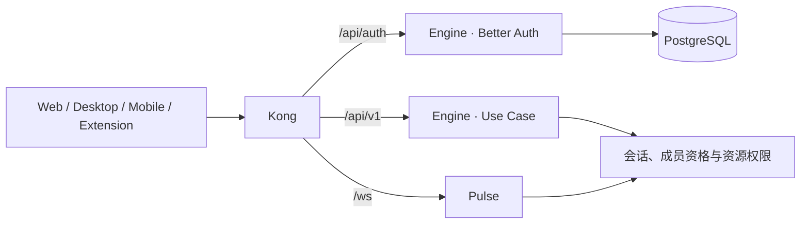

# 认证与授权

Better Auth 在 Engine 中提供 `/api/auth` 入口。Kong 将该路径转发到 Engine，客户端通过对应运行时适配器调用认证 API。



## 模块职责

| 模块                                     | 职责                                         |
| ---------------------------------------- | -------------------------------------------- |
| `auth-contract`                          | 通用会话、用户与权限类型                     |
| `auth-client-web` / `auth-client-native` | 浏览器与 Native 的认证调用适配               |
| `auth-server`                            | Better Auth 实例、插件、邮件回调与数据库适配 |
| `pg-dao/src/models/auth.prisma`          | 受控认证模型与关系                           |

配置入口是 [auth-server.ts](../../libs/auth-server/src/lib/auth-server.ts)。邮箱密码登录要求邮箱验证，因此完整注册流程需要可用邮件提供商；OAuth 需要对应平台的应用凭据和回调地址。插件是否启用以此配置为准。

## 授权

认证回答当前用户是谁；业务授权由服务端对每次操作检查。会话中的 `userId` 与 `activeOrganizationId` 决定身份上下文，组织操作还需要成员资格、角色与资源归属检查。隐藏按钮不能替代后端验证。

个人/组织切换见 [组织上下文](workspace-switching.md)。开发业务 API 时遵守根 `AGENTS.md` 与 `ray-api-flow`：通过 Use Case 处理业务读写，不能从客户端传入的所有者 ID 直接认定权限。

## 会话缓存

认证配置启用 5 分钟 Cookie 会话缓存。注销时客户端应应用服务端返回的清除 Cookie 响应；需要确认数据库中的会话已撤销时，使用 `get-session?disableCookieCache=true`。重放清除前的缓存 Cookie 不等同于正常客户端的注销行为，实时撤销场景应单独设计与验证。

## 修改认证模型

升级 Better Auth、增删数据库相关插件或修改认证字段后，运行：

```sh
pnpm nx run auth-server:schema-check
```

该命令在临时目录生成候选模型并比较差异，不修改数据库、不覆盖受控文件。审核变化后修改 Prisma 模型，并为自己的业务项目创建标准迁移。它不是普通开发或启动的前置步骤。比较范围与版本说明见 [认证检查](../../scripts/auth/README.md)。
