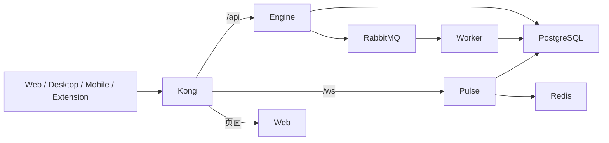

# Kong 网关与容器部署

Worker 是后台消费者，不通过 Kong 暴露业务端口。Kong 管理 API 默认关闭。服务和数据库位于 Compose 内网，外部只访问网关。

## 本地开发

`pnpm docker:dev` 启动 PostgreSQL、Redis、MongoDB、RabbitMQ 和 Kong。Kong 容器通过 `host.docker.internal` 访问本机 `dev:*` 服务。默认网关 http://localhost:8080，Engine 8000、Pulse 3001、Web 3000。

一次 `pnpm db:init` 完成 Prisma Client 生成与数据库初始化。运行三个后端服务及 Web 后即可通过网关访问，无需重放研发迁移、预先创建账号或准备发布状态文件。

## 服务器部署

使用 `docker/docker-compose.infra.yml` 与 `docker/docker-compose.app.yml` 组合。前者声明基础设施和 Kong，后者声明应用及一次性 Migrator。

GitHub 的 `Deploy Ray` workflow 手动触发，检查所选提交属于 main，构建镜像并用 digest 固定版本。需设置 production environment 与 `DEPLOY_HOST`、`DEPLOY_USER`、`DEPLOY_SSH_KEY`、`GHCR_PULL_TOKEN`；可选 `DEPLOY_PATH` 与 `DEPLOY_PORT`。仓库变量 `PUBLIC_ORIGIN` 和 `CONTACT_EMAIL` 用于 Web 构建；其他公开 `VITE_*` 按业务需要在构建 job 中配置。

部署主机在 `DEPLOY_PATH/.env` 配置数据库、Redis、RabbitMQ、认证密钥、`PUBLIC_ORIGIN`、`BETTER_AUTH_URL` 和业务需要的外部服务。公开 URL 应指向同一个网关域名。前端 `VITE_*` 在构建时注入，不能依赖容器启动后修改。

`deploy.sh` 的顺序固定为：拉取镜像 → 等待基础设施 → 运行迁移 → 启动应用与 Kong 并等待健康状态。空数据库只执行一份初始化迁移；已初始化数据库只执行项目后来新增的迁移。

## HTTPS

默认 HTTP 支持本地验证。公开部署可以在外层负载均衡器终止 TLS，或设置 `KONG_AUTO_TLS=true` 启用自带 ACME 插件；后者需真实 `DOMAIN`、`ACME_EMAIL`、对外的 80/443 端口和正确 DNS。设置 `PUBLIC_ORIGIN=https://你的域名`，认证 URL 同步使用 HTTPS。

## 更新

同一入口可重复发布。应用更新不清空数据库或持久卷；新版本有 schema 变化时先应用标准 Prisma migrations。应用镜像回退不会回退数据库，因此下游项目在上线后应审查兼容性并保留备份。这里没有框架专属的历史升级台账或切换开关。
